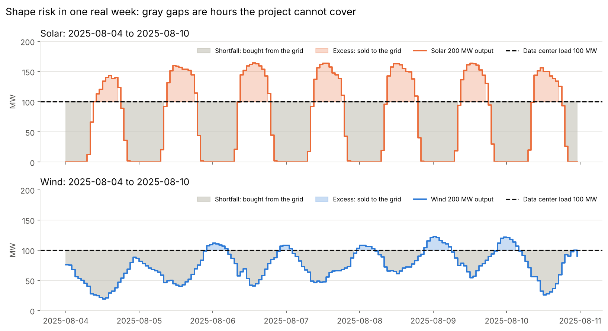
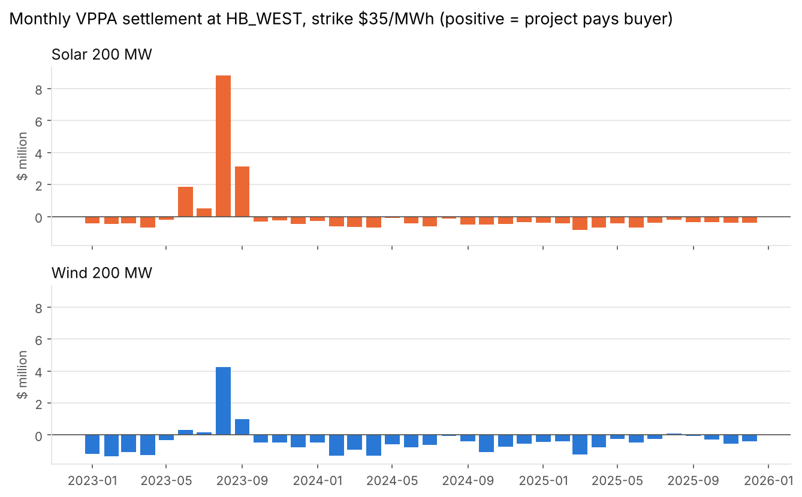
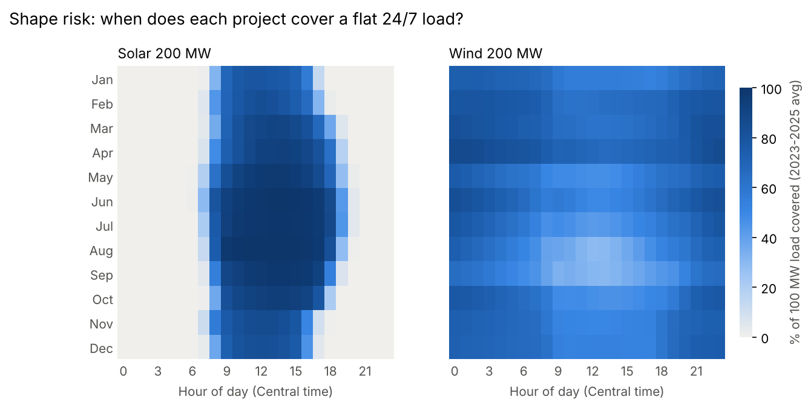
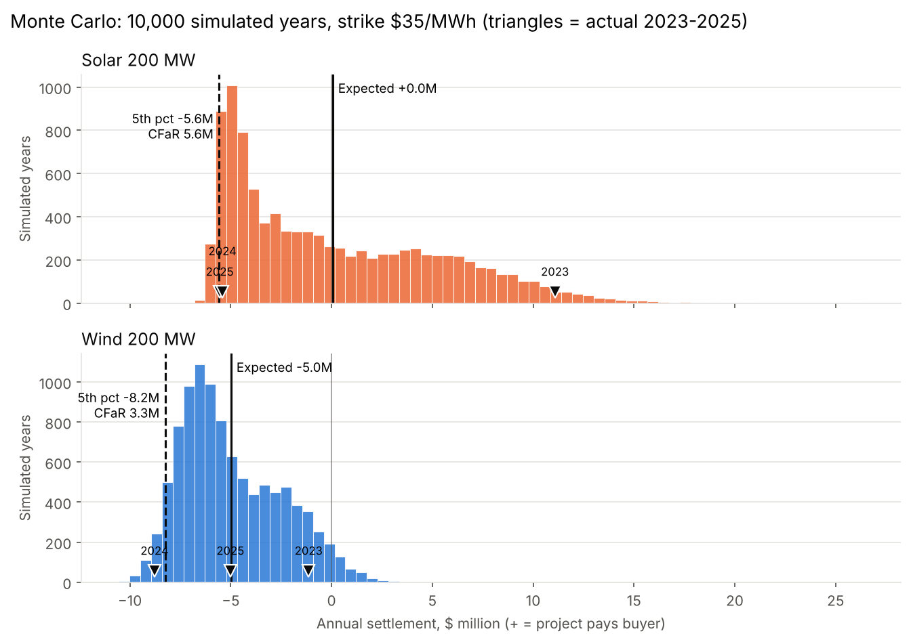
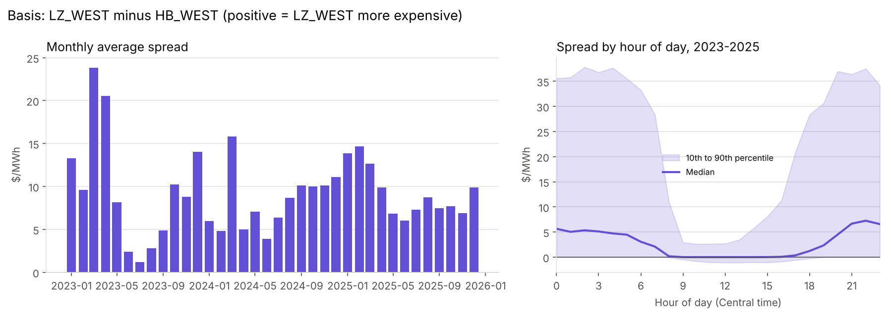
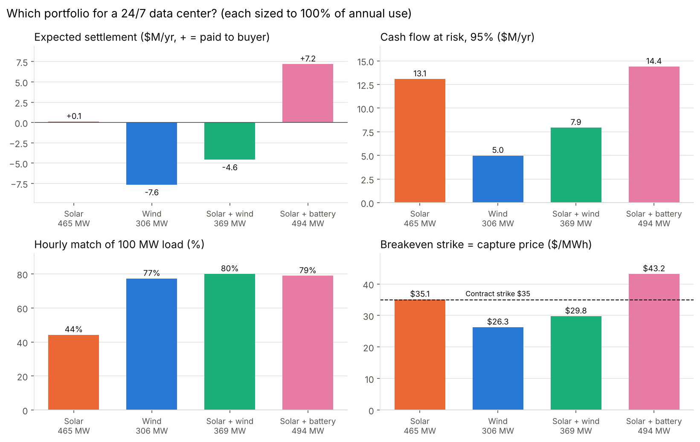
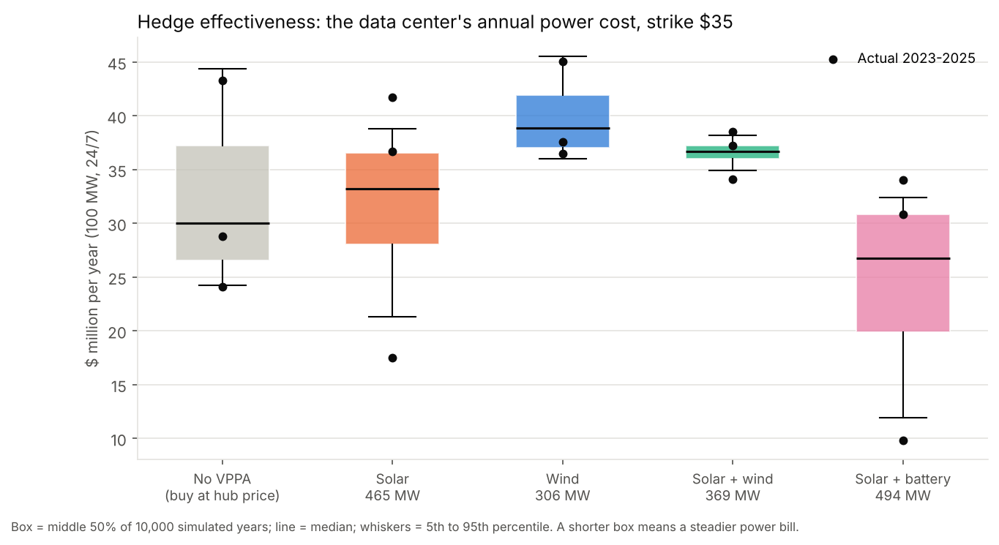

# vppa-risk-lab

Risk analytics for a hypothetical **virtual power purchase agreement (VPPA)** serving a **24/7 data center in ERCOT** (Texas).
Hourly settlement backtest, price / shape / basis / volume risk, a Monte Carlo of cash flow at risk,
a solar vs. wind vs. blend vs. solar + battery comparison, and a test of whether the VPPA actually hedges the buyer's power bill.

Built with **public ERCOT data only**. All projects, contract terms and the data center are hypothetical.

> **Start here:** [`notebooks/vppa_story.ipynb`](notebooks/vppa_story.ipynb) tells the whole story end to end, with every chart.

---

## 1. The problem

A data center uses a flat **100 MW, every hour of the year** in West Texas. It wants to back that use with clean energy
by signing a VPPA with a new wind or solar project. Before signing, a risk team needs answers to four questions:

1. **What would the contract have cost or paid** over recent years?
2. **What are the risks**, and how big is each one?
3. **How bad could a bad year be?**
4. **Which project type** (solar, wind, a blend, or solar + battery) best fits a 24/7 load, and **does the contract
   actually steady the buyer's power bill**?

## 2. How a VPPA works

### The contract

A VPPA is a **financial contract, not a power delivery**. The project sells its power into the ERCOT market as usual,
and every hour the two sides settle the difference between the market price and a fixed **strike** price:

```
settlement (hour) = (market price - strike) x MWh generated

  positive -> the project pays the buyer   (market price above strike)
  negative -> the buyer pays the project   (market price below strike)
```

The project ends up with a fixed revenue of strike x MWh, which lets it get financed. The buyer receives the
renewable energy certificates (RECs) and a financial position that moves with market prices.

### The buyer has two separate contracts

| | Retail electricity contract | VPPA |
|---|---|---|
| Counterparty | A retail electricity provider | The wind or solar project |
| What it does | Delivers the physical power the servers use | Purely financial; no electricity changes hands |
| Price term | Retail price per MWh (fixed or floating) | **Strike** price ($35/MWh in this project) |

The strike belongs to the VPPA. The retail contract is a separate decision, and it **determines whether the VPPA is a hedge**:

- **Index (floating) retail price:** the data center pays the wholesale price each hour. It carries price risk, and the
  VPPA offsets it: when prices spike, the bill rises but the VPPA pays out.
- **Fixed-price retail contract:** the retailer charges one flat rate and carries the price risk. The bill is already
  fixed, so the VPPA **adds** price swings instead of removing them.

One hour, 100 MWh produced and used, $35 strike:

| Market price | Index retail: power bill | VPPA settlement | **Net cost** | Fixed $50 retail: power bill | **Net cost** |
|---|---|---|---|---|---|
| $100/MWh | -$10,000 | +$6,500 | **-$3,500** | -$5,000 | **+$1,500** |
| $20/MWh | -$2,000 | -$1,500 | **-$3,500** | -$5,000 | **-$6,500** |

With index pricing the net cost is locked at $35/MWh whatever the market does: a hedge. With fixed-price retail the
VPPA becomes a bet on market prices. **This project assumes the data center buys at the hub price (index).**

### The buyer's risks

| Risk | The question | What drives it |
|---|---|---|
| **Price** | Is the market above or below my strike? | Gas prices, weather, scarcity hours |
| **Shape** | Is the power made *when* I use it? | Solar is daytime only; wind is strongest at night |
| **Basis** | Is the project's local price different from the hub? | Transmission congestion in West Texas |
| **Volume** | Is enough power made this year? | Calm or cloudy years |

## 3. Data sources

All public, downloaded with [`scripts/fetch_data.py`](scripts/fetch_data.py) and cached locally as parquet.

| Data | Source | Notes |
|---|---|---|
| Hourly prices at **HB_WEST** (the hub the VPPA settles at), 2023-2025 | ERCOT report [NP6-785-ER](https://www.ercot.com/mp/data-products/data-product-details?id=NP6-785-ER), Historical RTM Load Zone and Hub Prices, via [`gridstatus`](https://github.com/gridstatus/gridstatus) | 15-minute real-time prices averaged to hourly |
| Hourly ERCOT-wide solar and wind output | ERCOT [Interval Generation by Fuel](https://www.ercot.com/gridinfo/generation) annual workbooks | Annual totals reconcile exactly with ERCOT's own daily totals |
| Installed solar and wind capacity | ERCOT [Capacity Changes by Fuel Type](https://www.ercot.com/gridinfo/resource) | Year-end values, recorded in `vppa/profiles.py` |
| Hourly prices at **LZ_WEST** (the data center's load zone) | Same ERCOT report NP6-785-ER | Buyer-side basis risk |
| Resource-node prices *(pending)* | ERCOT Public API (free account) | Generator-side basis risk |

## 4. Method

| Step | Module | What it does |
|---|---|---|
| Data | `vppa/data.py` | Downloads and caches prices and generation; handles daylight-saving days |
| Proxy projects | `vppa/profiles.py` | Scales ERCOT-wide output to 200 MW projects using hourly **capacity factor** (output / installed capacity), so fleet growth is not mistaken for weather |
| Backtest | `vppa/settlement.py` | Hourly settlement, monthly and annual totals, **capture price** (generation-weighted price) and negative-price hours |
| Risk decomposition | `vppa/risk.py` | Price sensitivity and tail concentration; hourly vs. annual matching and shape cost; basis (load zone or node vs. hub); low-resource year; hedge effectiveness |
| Monte Carlo | `vppa/montecarlo.py` | 10,000 simulated years with a **two-step bootstrap**: for each month pick one historical year's version (keeps its regime), then draw whole real days from it (keeps price and generation paired) |
| Portfolio | `vppa/portfolio.py` | Solar, wind, 50/50 blend, and solar + 4-hour battery; each **sized to produce 100% of annual use** (size = load / capacity factor) so they differ only in *when* energy arrives |
| Charts | `vppa/plots.py` | One function per chart, saved to `figures/` |

**Model check that changed the method:** a first Monte Carlo drew days from all three years mixed together. Every
simulated year came out close to average, and the actual 2024 result fell *outside* the simulated range. Keeping each
month's regime fixed roughly doubled cash flow at risk and brought every actual year inside the range.

## 5. Key charts

**Shape risk in one real week.** Gray gaps are hours the project cannot cover; the data center buys that power from
the grid, which in Texas is mostly natural gas.



**Monthly settlement at a $35 strike.** One heat-wave month (August 2023) dominates the solar result.



**When each project covers a flat 24/7 load.** Solar and wind are complementary: solar is strongest on summer
afternoons, exactly when wind is weakest.



**Monte Carlo: 10,000 simulated years.** Triangles are the actual 2023-2025 results.



**Basis risk, buyer side.** The data center pays LZ_WEST, but the VPPA settles at HB_WEST. LZ_WEST was usually
more expensive, especially at night when West Texas wind congests the transmission lines.



**Portfolio comparison, each option sized to 100% of annual use.**



**Hedge effectiveness: the data center's annual power cost with and without each VPPA.** A shorter box means a steadier bill.



More charts (price sensitivity, negative-price hours, volume risk, battery operation, capacity factors) are in
[`figures/`](figures/) and in the notebook.

## 6. Findings

> **DRAFT - to be rewritten in the author's own words.** Numbers: HB_WEST hub, $35/MWh strike, 2023-2025 data,
> 10,000 simulated years, each option sized to 100% of the data center's annual use.

| | Solar | Wind | **Solar + wind** | Solar + battery |
|---|---|---|---|---|
| Size | 465 MW | 306 MW | 369 MW | 494 MW + 247 MW / 988 MWh |
| Hourly match of the 100 MW load | 44% | 77% | **80%** | 79% |
| Expected VPPA settlement ($M/yr) | +0.1 | -7.6 | -4.6 | +7.2* |
| Cash flow at risk, 95% ($M/yr) | 13.1 | 5.0 | 7.9 | 14.4 |
| Breakeven strike = capture price ($/MWh) | 35.1 | 26.3 | 29.8 | 43.2 |
| Average annual power bill ($M; $32.0M with no VPPA) | 31.9 | 39.7 | 36.6 | 24.9* |
| Year-to-year swing in the bill removed | 15% | 53% | **85%** | -3% |

\* Battery cost is not modeled; a real solar + storage contract would carry a higher strike.

1. **At a $35 strike, a solar + wind VPPA is a strong hedge but not a cheap one.** It removes about 85% of the
   year-to-year swing in the data center's power bill and caps a 1-in-20 bad year near $38M instead of $44M. It also
   gives the best hourly clean-energy match (80%). In exchange, the average bill is about $4.6M a year higher, because
   West Texas prices in 2023-2025 mostly sat below $35. Its breakeven strike (about $30/MWh) is the number to negotiate toward.
2. **Price risk lives in the tails.** For the 200 MW solar contract, the top 1% of price hours earned the buyer about
   +$14.7M over three years while the other 99% cost about -$14.6M.
3. **Solar's value collapsed as Texas solar grew.** Its capture price went from about $17/MWh *above* the hub average
   in 2023 to about $12/MWh *below* it in 2025, as midday prices fell and the evening peak rose.
4. **Solar alone** is cheapest on average at this strike but leaves most hours uncovered and has the widest swings.
   **Wind alone** is the most predictable contract but the most costly, and it hedges the bill less well than the blend.
5. **Solar + battery over-hedges.** As sized here, it pushes so much energy into scarcity hours that the bill swings the
   other way (about $10M in 2023 vs. $34M in 2025). A smaller battery, or storage added to the blend, is the next test.
6. **Location costs the buyer about $8M a year that the VPPA does not hedge.** The data center's load zone (LZ_WEST)
   averaged about $8-10/MWh above the HB_WEST hub, adding $7.3-8.8M a year to a 100 MW load's bill. Buying at
   LZ_WEST raises the unhedged average bill from $32.0M to $40.1M, and the blend then removes about 78% of the
   year-to-year swing instead of 85%, because the VPPA tracks the hub while the bill follows the load zone.
7. **Volume risk is not only about money.** When prices are mostly below strike, a calm year *reduces* VPPA payments,
   but it still cuts RECs and hourly match and weakens the hedge.
8. **The hedge only exists if the buyer pays market prices.** With a fixed-price retail contract, the same VPPA adds risk.

## 7. Limitations

- **Hedge assumption:** the main results assume the data center buys at the HB_WEST price; a load-zone (LZ_WEST)
  version is in the notebook. Wires and retail charges are excluded, and with a fixed-price retail contract the VPPA
  would not be a hedge at all.
- **Generator-side basis is pending:** all VPPA settlement is at the hub, and node prices need the ERCOT Public API.
  West Texas wind nodes often price below the hub; in a hub-settled contract that risk sits with the project.
- **Proxy generation:** profiles are ERCOT-wide output scaled to 200 MW. A statewide fleet is smoother than one plant,
  so shape and volume risk are probably understated. Metered output also excludes curtailed energy.
- **Installed capacity** is known only at year ends and interpolated linearly between them.
- **Short history:** three years, with only three versions of each month in the Monte Carlo and months drawn
  independently. No event like Winter Storm Uri (February 2021) is included. Treat cash flow at risk as a floor.
- **Market rules changed:** prices predate ERCOT's real-time co-optimization (RTC+B) launch in December 2025.
- **Hourly, not 15-minute, settlement:** real contracts often settle each 15-minute interval.
- **Battery:** a simple rule (charge from surplus solar, discharge into shortfalls), with no price optimization and no cost.
- **2024 generation data** includes one month of ERCOT "initial" (not yet "final") settlement figures.

## 8. Next steps

1. **Generator-side basis:** add a West Texas wind resource node and measure the cost of node vs. hub settlement.
2. **Smaller battery and blend + storage:** find the storage size that steadies the bill instead of over-hedging.
3. **Strike sensitivity:** chart hedge cost and hedge effectiveness across strikes.
4. **Second market:** extend to **PJM** (mid-Atlantic, the largest US data center market) or **CAISO** (California,
   solar-heavy with deep midday price dips) to compare how the same contract behaves elsewhere.
5. **Stress scenarios:** add a Winter Storm Uri-style week to the Monte Carlo.

## 9. Run it yourself

```bash
git clone https://github.com/andrepaoPeru/vppa-risk-lab.git
cd vppa-risk-lab
pip install -r requirements.txt
python scripts/fetch_data.py          # first run downloads ~3 years of ERCOT data (a few minutes)
python -m pytest                      # 45 tests of the settlement, risk, Monte Carlo and battery math
jupyter notebook notebooks/vppa_story.ipynb
```

Change any assumption (hub, years, project sizes, load, strike, battery) in [`vppa/config.py`](vppa/config.py),
or set `STRIKE` in the notebook's first cell. Tested with Python 3.13.

```
vppa-risk-lab/
├── vppa/              # config, data, profiles, settlement, risk, montecarlo, portfolio, plots
├── scripts/           # fetch_data.py: builds the local data cache
├── notebooks/         # vppa_story.ipynb: the end-to-end story
├── tests/             # pytest tests on small hand-checked examples
└── figures/           # charts used here and in the notebook
```

## 10. Further reading

- EPA Green Power Partnership, [Introduction to Virtual Power Purchase Agreements](https://www.epa.gov/green-power-markets/introduction-virtual-power-purchase-agreements)
- FERC, [Energy Primer: A Handbook of Energy Market Basics](https://www.ferc.gov/media/energy-primer-handbook-energy-market-basics)
- ERCOT, [Nodal Protocols](https://www.ercot.com/mktrules/nprotocols) (settlement point prices, Section 6)
- Lawrence Berkeley National Laboratory, [utility-scale solar and wind market reports](https://emp.lbl.gov/renewable-energy)
- Efron & Tibshirani, *An Introduction to the Bootstrap*

## About this project

> *AI assistance (edit or remove): Built with an AI coding assistant. I defined the questions, chose the methods,
> validated the results against history, and wrote the findings; I can walk through every line.*

MIT License. Uses public data only; no confidential information from any employer.
